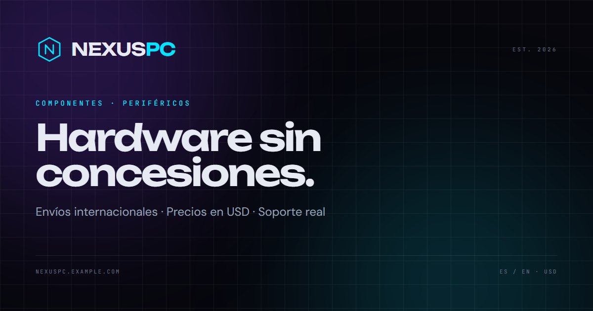

# NEXUS PC

Tienda de componentes y periféricos de PC con una identidad visual futurista, catálogo bilingüe (ES/EN) y checkout simulado. Proyecto demo construido con Next.js 15, React 19 y Tailwind CSS 4.



## Características

- **Home** con hero interactivo, fondo animado por scroll, ofertas con contador y newsletter.
- **Catálogo** de 28 productos con filtros por categoría, marca, precio, stock y orden, todo desde la URL (server-driven).
- **Página de producto** con galería, especificaciones, compatibilidad, reseñas, relacionados y comparador.
- **Carrito y checkout simulados**: envío estándar/express, envío gratis desde $500 USD, impuesto del 8% y número de pedido `NX-XXXXXX`.
- **Cuenta demo**: historial de pedidos, direcciones y wishlist persistidos en `localStorage`.
- **Comparador** de hasta 4 productos vía URL (`?p=slug1,slug2`).
- **Guías de compra** (5 artículos bilingües) con tabla de contenidos, productos recomendados y datos estructurados JSON-LD.
- **Soporte** con políticas, FAQ y formulario de contacto simulado (`SUP-XXXXXX`).
- **Bilingüe** ES/EN con `next-intl`, rutas idénticas y prefijo de locale (`/es`, `/en`).
- **SEO**: canonical + hreflang, Open Graph/Twitter, `sitemap.xml`, `robots.txt` y 404 personalizado.
- **Accesibilidad**: skip link, jerarquía de encabezados, foco visible, formularios con errores anunciados.

## Stack

| Herramienta | Versión |
| --- | --- |
| Next.js | 15.5.28 |
| React | 19 |
| TypeScript | 5.9.3 |
| Tailwind CSS | 4 |
| next-intl | 4 |
| Zustand | 5 |
| lucide-react | — |

## Empezar

```bash
npm install
npm run dev
```

Abre [http://localhost:3000](http://localhost:3000).

### Scripts

```bash
npm run dev        # desarrollo
npm run build      # build de producción
npm run start      # servidor de producción
npm run typecheck  # TypeScript
```

### Variables de entorno

| Variable | Descripción |
| --- | --- |
| `NEXT_PUBLIC_SITE_URL` | URL pública del sitio (canonical, sitemap y OG). Por defecto `https://nexuspc.example.com`. |

## Estructura

```
src/
├─ app/[locale]/      # páginas (home, tienda, producto, carrito, checkout, cuenta, guías, soporte…)
├─ components/        # UI, layout, producto, carrito, checkout, guías, soporte
├─ config/            # navegación, iconos de categorías, compatibilidad
├─ data/              # catálogo, guías y soporte (contenido demo)
├─ i18n/              # routing y navegación localizada
├─ lib/               # carrito, checkout, pedidos, formato, SEO
└─ messages/          # traducciones es.json / en.json
```

## Notas

- Todos los datos (productos, pedidos, formularios) son **demo**: no hay backend ni pagos reales.
- El carrito, la wishlist y los pedidos se guardan en `localStorage` del navegador.
- Diseño solo en modo oscuro, precios en USD y envíos internacionales simulados.

---

Demo project — not affiliated with any hardware manufacturer.
